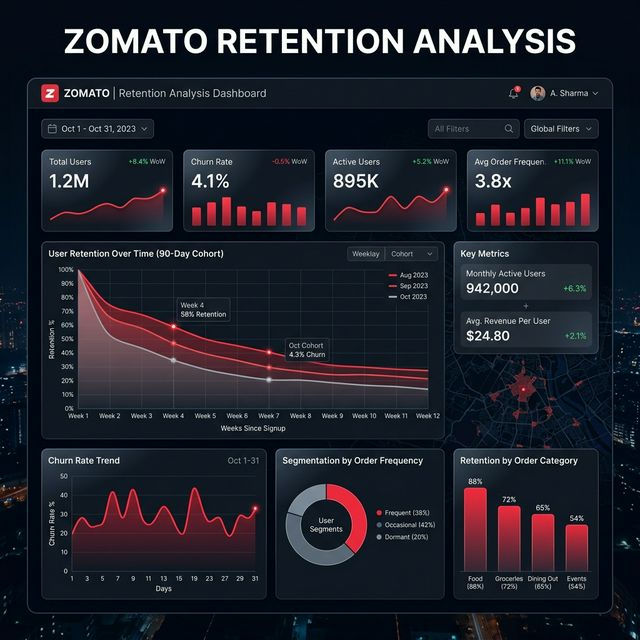

# Zomato Retention Analysis



> **Live Website:** [zomato-retention-analysis-project.vercel.app](https://zomato-retention-analysis-project.vercel.app/)

An end-to-end customer retention analytics project: synthetic order data, a SQL layer, supervised churn prediction, unsupervised customer segmentation, time-series forecasting, and two dashboards (a custom React app and a Power BI report).

> **About the data:** all data is **synthetic**, generated by `src/generate_data.py` (1,000 users). Churn is generated from a logistic function of order count, rating and recency, so models have a real but artificial signal to learn. Results below describe this synthetic dataset, not real Zomato customers.

---

## What's inside

| Layer | What it does | Tools |
|---|---|---|
| Data generation | 1,000 users, monthly activity history, 24-month order series | Python (pandas, NumPy) |
| SQL | Cohort retention (CTEs) and RFM scoring (`NTILE` window functions) on a SQLite database | SQL, SQLite |
| Churn prediction | Random Forest classifier, served via `/predict` and `/metrics` | scikit-learn |
| Segmentation | K-Means on RFM features, *k* chosen by silhouette score | scikit-learn |
| Forecasting | SARIMA of monthly order volume, backtested against two naive baselines | statsmodels |
| EDA | Correlation heatmap, cohort retention heatmap | seaborn, matplotlib |
| API | `/health /stats /data /predict /metrics /segments /forecast` | FastAPI |
| Dashboard 1 | Interactive React app | React, Vite, Recharts |
| Dashboard 2 | Star-schema Power BI report (cohort heatmap, risk segments, retention curve) | Power BI |

---

## Results (synthetic data)

**Churn classifier (Random Forest, 80/20 stratified split):**
accuracy 0.77, precision 0.73, recall 0.64, F1 0.68, ROC-AUC 0.84 (5-fold CV accuracy 0.78 ± 0.02). The majority-class baseline is about 0.62. Feature importance: days since last order 0.45, orders 0.32, rating 0.23.

**K-Means segments (k = 3, silhouette 0.41):** Loyal (353 users, 13% churn), At-Risk (487, 44%), Dormant (160, 81%). Churn was *not* an input to the clustering, yet churn rate rises steadily across the segments.

**SARIMA forecast (last 6 months held out):**

| Model | RMSE | MAE |
|---|---|---|
| Persistence baseline | 500.5 | 436.3 |
| Seasonal naive baseline | 652.8 | 606.5 |
| SARIMA (1,1,1)(1,0,1,12) | **431.0** | **375.3** |

---

## Limitations (please read)

- **Synthetic data.** The relationships the models find were put there by the generator. Good scores show the pipeline works, not that these patterns exist in real customers.
- **SARIMA on 24 points.** The series has only two seasonal cycles, and its trend and seasonality were built in by the generator. Seasonal differencing (D=1) diverged on 18 training months, so a model without seasonal differencing was chosen after comparing several orders by backtest. Treat the forecast as a demonstration of method.
- **Region and acquisition channel** have no effect on churn in the generated data; their charts look flat by design.
- **K-Means labels** (Loyal / At-Risk / Dormant) are assigned from cluster centres. Clusters are multivariate, so a cluster's label may not match every single metric (the At-Risk cluster has slightly *more* recent orders than Loyal but much lower frequency and spend).
- **Power BI report** contains the Random Forest risk predictions and the activity data. The K-Means segments and the SARIMA forecast appear in the React dashboard only.

---

## Project structure

```
backend/      FastAPI app + Random Forest (model.py, main.py, requirements.txt)
frontend/     React + Vite dashboard
src/          generate_data.py, segmentation.py, forecasting.py, eda.py, export_powerbi.py
sql/          build_db.py, cohort_retention.sql, rfm_scoring.sql, run_queries.py
data/         generated CSVs, zomato.db, powerbi_model/ (star schema for Power BI)
outputs/      heatmaps and forecast chart (PNG)
powerbi/      Power BI report and notes
```

---

## Run it locally

```bash
pip install -r backend/requirements.txt pandas matplotlib seaborn

python src/generate_data.py      # data + monthly activity + order series
python sql/build_db.py           # load SQLite database
python sql/run_queries.py        # cohort retention + RFM segments
python src/segmentation.py       # K-Means segments
python src/forecasting.py        # SARIMA backtest + forecast chart
python src/eda.py                # heatmaps -> outputs/
python src/export_powerbi.py     # star-schema CSVs for Power BI

cd backend && uvicorn main:app --reload      # API at http://localhost:8000/docs
cd frontend && npm install && npm run dev    # dashboard
```

The Power BI report loads the four CSVs in `data/powerbi_model/` (`Dim_Users`, `Dim_Date`, `Fact_Activity`, `Fact_Predictions`) with relationships `Dim_Users[user_id]` → `Fact_Activity[user_id]`, `Dim_Users[user_id]` → `Fact_Predictions[user_id]` and `Dim_Date[month]` → `Fact_Activity[month]`.

---

## Deployment

**Backend (Render, Docker):** deploy as a Web Service using the root `Dockerfile` (it installs the pinned requirements and copies `backend/`, `src/` and `data/`). Verified by running every endpoint against the pinned requirements in a clean environment laid out like the container.

**Frontend (Vercel):** deploy the `frontend/` folder and set `VITE_API_URL` to your Render URL.

The previous single-project Vercel setup for the Python backend (`vercel.json`) has **not** been tested with the scikit-learn / statsmodels dependencies and may exceed Vercel's serverless size limit, so the split deployment above is the supported route.
